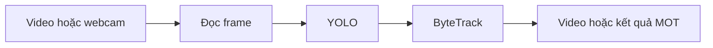

# Real-Time Object Detection & Tracking

Dự án Computer Vision sử dụng **YOLO + ByteTrack** để phát hiện và theo dõi nhiều đối tượng trong video hoặc webcam. YOLO xác định vị trí và lớp của đối tượng trong từng khung hình. ByteTrack liên kết các phát hiện giữa các khung hình để duy trì **track ID** trong cùng một luồng video.

**Trạng thái:** Đang triển khai. CLI, định dạng đầu ra và quy trình đánh giá dưới đây là thiết kế dự kiến. Kết quả thực nghiệm sẽ được bổ sung sau khi pipeline chạy ổn định.

## 1. Đầu vào và đầu ra

| Thành phần | Mô tả |
|---|---|
| Đầu vào demo | Video MP4 hoặc webcam |
| Đầu vào đánh giá | Chuỗi ảnh MOT17 và nhãn chuẩn tương ứng |
| Kết quả trực quan | Video có bounding box, tên lớp và track ID |
| Kết quả đánh giá | Dự đoán định dạng MOT, điểm theo từng sequence và thống kê tốc độ |
| Phần cứng mục tiêu | NVIDIA RTX 4060 Laptop GPU 8 GB. Chạy CPU để kiểm tra chức năng khi cần. |

Ví dụ, khi hai người đi qua nhau, mục tiêu của tracker là giữ ID của mỗi người trước và sau khi họ giao nhau. Che khuất lâu, chuyển động camera mạnh và detection bị bỏ sót có thể làm track bị đứt hoặc đổi ID.

## 2. Kiến trúc



- **OpenCV** đọc frame, vẽ kết quả và ghi video.
- **YOLO pretrained** dự đoán bounding box, độ tin cậy và class ID.
- **ByteTrack** liên kết detection có confidence cao trước, sau đó dùng detection có confidence thấp để hỗ trợ duy trì những track còn chưa ghép được. Trạng thái tracker được duy trì trong một video và khởi tạo lại khi chuyển sang video khác.
- **TrackEval** đối chiếu kết quả dự đoán với ground truth MOT17.

Tài liệu: [Ultralytics Tracking](https://docs.ultralytics.com/modes/track/), [ByteTrack](https://github.com/FoundationVision/ByteTrack), [TrackEval](https://github.com/JonathonLuiten/TrackEval).

## 3. Cấu trúc repository

| File | Trách nhiệm |
|---|---|
| `requirements.txt` | Phiên bản các thư viện Python. |
| `configs/default.yaml` | Weights, thiết bị, ngưỡng confidence và cấu hình tracker. |
| `src/video_io.py` | Đọc video hoặc webcam, ghi video kết quả. |
| `src/detector.py` | Nạp YOLO và chạy phát hiện đối tượng. |
| `src/tracker.py` | Quản lý trạng thái tracking theo luồng video. |
| `src/visualize.py` | Vẽ bounding box, tên lớp, track ID và FPS. |
| `main.py` | Điểm chạy CLI, nối các bước xử lý. |
| `scripts/prepare_mot17.py` | Tìm sequence, kiểm tra `img1`, `seqinfo.ini` và `gt/gt.txt`. |
| `scripts/benchmark.py` | Đo FPS và độ trễ xử lý. |
| `scripts/evaluate_mot.py` | Xuất dự đoán MOT và chạy đánh giá. |
| `.gitignore` | Bỏ qua môi trường ảo, dữ liệu tải về, weights và output. |
| `README.md` | Hướng dẫn sử dụng và tái lập kết quả. |

Đặt video demo trong `data/input/`, bộ MOT17 trong `data/mot17/`, weights trong `weights/` và kết quả sinh ra trong `outputs/`.

## 4. Chuẩn bị trên Windows

Cài Git và Python 3.11, sau đó dùng PowerShell. Nếu đã có thư mục project trên ổ D:, chuyển thẳng tới thư mục đó.

```powershell
cd D:\Real-Time-Object-Detection-Tracking
py -3.11 -m venv .venv
```

Sau khi `requirements.txt` đã khai báo đầy đủ dependencies, cài chúng vào môi trường ảo:

```powershell
.\.venv\Scripts\python.exe -m pip install -r requirements.txt
```

Với cấu hình GPU, chọn bản PyTorch hỗ trợ CUDA phù hợp từ [hướng dẫn cài đặt PyTorch](https://pytorch.org/get-started/locally/). Kiểm tra bằng:

```powershell
.\.venv\Scripts\python.exe -c "import torch; print(torch.cuda.is_available())"
```

## 5. Dữ liệu và demo

1. **Kiểm tra pipeline:** tải [video gốc MOT17-02-FRCNN](https://motchallenge.net/sequenceVideos/MOT17-02-FRCNN-raw.mp4), lưu thành `data/input/MOT17-02-FRCNN.mp4`.
2. **Đánh giá tracking:** tải [MOT17.zip](https://motchallenge.net/data/MOT17.zip) (khoảng 5,5 GB) và giải nén vào `data/mot17/`. Dùng các sequence có ground truth trong split `train` để đánh giá cục bộ.
3. **Lọc lớp người khi chấm MOT17.** Nếu dùng cùng ảnh với YOLO tự phát hiện, chọn một biến thể cho mỗi cảnh, ví dụ `FRCNN`, để tránh tính lặp các cảnh có cùng khung hình. Ghi rõ danh sách sequence và cấu hình trong báo cáo.

Nguồn: [MOT17 – MOTChallenge](https://motchallenge.net/data/MOT17/).

### Ví dụ CLI dự kiến

Sau khi các tham số được triển khai trong `main.py`, lệnh demo trên Windows sẽ có dạng:

```powershell
.\.venv\Scripts\python.exe main.py --source data/input/MOT17-02-FRCNN.mp4 --output outputs/mot17_demo.mp4
```

Khi thử webcam, dùng `--source 0`. Khi chấm MOT17, chạy trên ảnh gốc theo thứ tự frame để đối chiếu trực tiếp với nhãn chuẩn.

## 6. Đánh giá và benchmark

| Chỉ số | Cách đọc |
|---|---|
| HOTA | Đánh giá cả chất lượng phát hiện và liên kết đối tượng giữa các frame. |
| IDF1 | Đánh giá mức độ khớp danh tính giữa các dự đoán và nhãn chuẩn. |
| ID switches | Số lần danh tính theo dõi bị đổi theo quy tắc của bộ chấm. |
| FPS | Số frame xử lý mỗi giây. Tách FPS của pipeline khỏi tốc độ khung hình của video đầu vào. |
| Độ trễ P50/P95 | Thời gian xử lý điển hình và ở nhóm frame chậm. |

Khi đo tốc độ, chạy warm-up rồi ghi rõ thiết bị, weights, kích thước ảnh và phạm vi đo, ví dụ chỉ inference hoặc toàn bộ luồng từ đọc frame đến ghi video. Khi chấm tracking, xuất một file dự đoán cho mỗi sequence, giữ đúng chỉ số frame và quy ước tọa độ theo TrackEval. Ghi rõ những sequence đã dùng để chỉnh tham số khi trình bày kết quả.

### Kết quả thực nghiệm

| Cấu hình | Sequence | HOTA | IDF1 | ID switches | FPS | P95 |
|---|---|---|---|---|---|---|
| YOLO + ByteTrack | MOT17-02-FRCNN | Chờ đo | Chờ đo | Chờ đo | Chờ đo | Chờ đo |

## 7. Mốc hoàn thành

- [ ] Chạy được video MP4 và xuất video có bounding box, class và track ID.
- [ ] Chạy được webcam và giải phóng camera khi kết thúc.
- [ ] Xuất dự đoán theo định dạng MOT và chấm được ít nhất một sequence bằng TrackEval.
- [ ] Đo FPS và P95 trên RTX 4060 Laptop, ghi kèm cấu hình.
- [ ] Thêm ảnh hoặc clip demo và kết quả thực nghiệm vào README.
